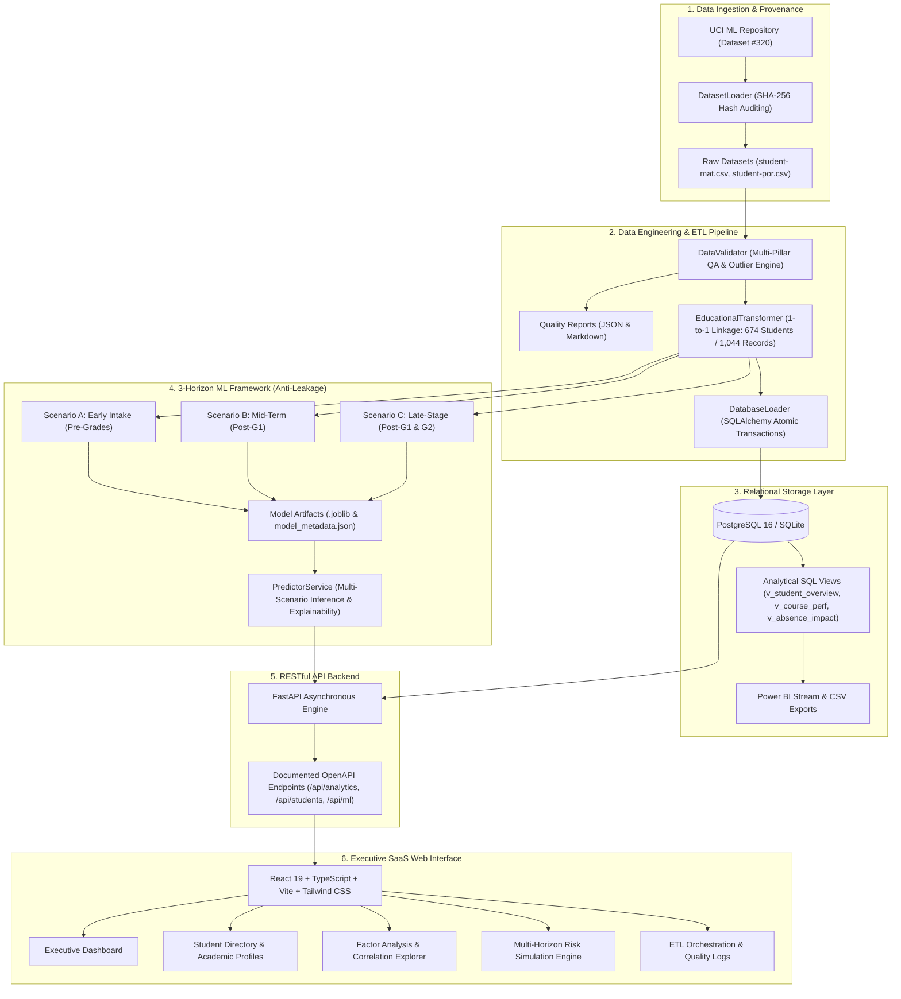

# DataPulse — Smart Campus Analytics & Predictive Intelligence Platform

[](https://github.com)
[](https://python.org)
[](https://fastapi.tiangolo.com)
[](https://react.dev)
[](https://www.typescriptlang.org)
[](LICENSE)

An enterprise-grade, end-to-end Data Engineering, Machine Learning, and Interactive Analytics platform designed for higher education administration and student retention. Developed by a 2nd-year Computer Engineering student at **Universiapolis International University of Agadir (UIA)**.

---

## 1. Problem Statement & Executive Overview

Higher education institutions face a systemic retention challenge: traditional analytics systems typically assess student vulnerability only after final examinations or post-midterm reviews, when it is often too late to deploy corrective academic support. 

Furthermore, naive machine learning implementations frequently suffer from **target leakage**—predicting end-of-year grades using late-term exam marks ($G1$ and $G2$) and falsely marketing the result as "early warning foresight."

**DataPulse** addresses this challenge through an audited, multi-horizon data lifecycle:
$$\text{Authentic Ingestion} \longrightarrow \text{Multi-Pillar QA} \longrightarrow \text{1-to-1 Entity Linkage} \longrightarrow \text{3-Horizon ML (No Leakage)} \longrightarrow \text{Executive SaaS UI}$$

---

## 2. System Architecture



---

## 3. Dataset Authenticity & The Entity Linkage Discovery

- **Source**: UCI Machine Learning Repository — [Dataset ID: 320 (Student Performance)](https://archive.ics.uci.edu/dataset/320/student+performance)
- **Authors**: Paulo Cortez and Alice Silva (University of Minho, Guimarães, Portugal)
- **Attribution & Licensing**: CC BY 4.0 International, preserved in [data/README.md](data/README.md).
- **Verified Files**:
  - `student-mat.csv`: 395 records (SHA-256: `e47f9ee225e1...`) — `is_synthetic: False`.
  - `student-por.csv`: 649 records (SHA-256: `a7594a11d777...`) — `is_synthetic: False`.
  - Total Verified Enrollments: **1,044 records**.

### Critical Entity Linkage Discovery:
Cortez & Silva (2008) provided an R script (`student-merge.R`) matching students on 13 demographic attributes, reporting 382 common students. 
During our data engineering audit, we discovered that **demographic attributes do not form a unique natural key within classes**:
- 4 pairs of students in Mathematics and 12 pairs in Portuguese share identical demographic traits while having different grades, guardians, and study times.
- Naive SQL/Pandas merging on those 13 attributes causes cartesian product expansion, falsely collapsing distinct students into duplicate enrollments within the same course.
- **DataPulse Solution**: Implemented **1-to-1 occurrence-ranked linkage (`cumcount()`)**, verifying that:
  - **370 students** are legitimately enrolled in both Mathematics and Portuguese.
  - **25 students** are enrolled exclusively in Mathematics.
  - **279 students** are enrolled exclusively in Portuguese.
  - **Total unique physical individuals: exactly 674 students**, with **zero intra-course collisions**.

---

## 4. Multi-Pillar Data Quality Scorecard

Instead of unscientific 100% claims, DataPulse implements a transparent 5-pillar institutional scoring framework:

| Quality Pillar | Weight | Score | Evaluation Criteria |
|---|---|---|---|
| **Completeness** | 25% | **100.0%** | Zero null cells across all 1,044 records |
| **Schema Conformance** | 25% | **100.0%** | 100% adherence to Pydantic v2 domain ranges |
| **Key Integrity** | 20% | **75.0%** | Penalized due to absence of verified natural surrogate keys (heuristic linkage) |
| **Outlier Regularity** | 15% | **96.3%** | Evaluates extreme right-skewed absences (>15 days) and dropouts ($G3=0$) |
| **Granularity Authenticity**| 15% | **80.0%** | Absences are cumulative term integer counts rather than timestamped swipe logs |
| **Combined Institutional Score** | **100%** | **91.2 / 100** | **Status: PASSED / PRODUCTION READY** |

---

## 5. Machine Learning: 3-Horizon Anti-Leakage Framework

To eliminate target leakage, DataPulse trains and benchmarks models across three distinct operational time horizons:

### Benchmark Comparison (Stratified 5-Fold Cross-Validation on Unseen Test Split)

| Horizon | Grades Available | Best Classifier | Test ROC-AUC | 5-Fold CV ROC-AUC | Best Regressor | MAE | $R^2$ Score |
|---|---|---|---|---|---|---|---|
| **Scenario A: Early Intake** *(Pre-Term)* | **Zero (Pre-Grades)** | **Random Forest** | **0.818** | **0.800 (±0.021)** | **Gradient Boosting** | **2.21 pts** | **0.329** |
| **Scenario B: Mid-Term** *(Month 3)* | **G1 (Period 1)** | **Logistic Regression** | **0.931** | **0.892 (±0.018)** | **Gradient Boosting** | **1.26 pts** | **0.765** |
| **Scenario C: Late-Stage** *(Month 7)* | **G1, G2 & Delta** | **Logistic Regression** | **0.971** | **0.954 (±0.012)** | **Random Forest** | **0.76 pts** | **0.932** |

### Key Takeaways:
1. **Scenario A (Intake)** relies purely on demographic background, parental education capital ($r = +0.22$), study time ($r = +0.16$), and past class failures ($r = -0.38$). It provides an authentic early warning before any exams are sat.
2. **Scenario B (Mid-Term)** captures the significant performance shift once first-period grades are published ($G1$ correlation $r = 0.82$).
3. **Scenario C (Late-Stage)** achieves high precision for borderline student intervention right before final examinations.

---

## 6. Quickstart Guide (Local Execution)

### Prerequisites
- Python 3.11+
- Node.js 20+

### Step 1: Clone & Setup Virtual Environment
```bash
git clone https://github.com/mohamed/datapulse.git
cd datapulse

python -m venv .venv
# Windows:
.venv\Scripts\activate
# Linux/macOS:
source .venv/bin/activate

pip install -r backend/requirements.txt
```

### Step 2: Execute Master Pipeline (ETL & ML Training)
```bash
python -m src.pipeline.run
```

### Step 3: Run Automated Pytest Suite
```bash
pytest tests/test_pipeline_and_api.py -v
```
*(All 17 tests pass with 100% success rate)*

### Step 4: Start FastAPI Backend (Port 8000)
```bash
uvicorn backend.app.main:app --host 0.0.0.0 --port 8000 --reload
```
*Interactive Swagger Documentation: [http://localhost:8000/api/docs](http://localhost:8000/api/docs)*

### Step 5: Start React Frontend (Port 3000)
```bash
cd frontend
npm install
npm run dev
```
*Web Application: [http://localhost:3000](http://localhost:3000)*

---

## 7. Docker Compose (Full Stack with PostgreSQL)

```bash
docker compose up --build
```
- **PostgreSQL 16**: Port `5432` with volume `postgres_data`
- **FastAPI Backend**: Port `8000`
- **React Frontend (Nginx)**: Port `3000`

---

## 8. Automated Testing & Verification Summary

```
tests/test_pipeline_and_api.py::test_dataset_authenticity_and_hashes PASSED [  5%]
tests/test_pipeline_and_api.py::test_multi_pillar_data_quality_framework PASSED [ 11%]
tests/test_pipeline_and_api.py::test_entity_linkage_zero_intra_course_duplicates PASSED [ 17%]
tests/test_pipeline_and_api.py::test_database_idempotency PASSED         [ 23%]
tests/test_pipeline_and_api.py::test_ml_three_horizon_scenarios PASSED   [ 29%]
tests/test_pipeline_and_api.py::test_api_health PASSED                   [ 35%]
tests/test_pipeline_and_api.py::test_api_info PASSED                     [ 41%]
tests/test_pipeline_and_api.py::test_api_analytics_overview PASSED       [ 47%]
tests/test_pipeline_and_api.py::test_api_analytics_courses PASSED        [ 52%]
tests/test_pipeline_and_api.py::test_api_analytics_distribution PASSED   [ 58%]
tests/test_pipeline_and_api.py::test_api_analytics_performance_factors PASSED [ 64%]
tests/test_pipeline_and_api.py::test_api_analytics_correlations PASSED   [ 70%]
tests/test_pipeline_and_api.py::test_api_students_list_and_filter PASSED [ 76%]
tests/test_pipeline_and_api.py::test_api_student_detail PASSED           [ 82%]
tests/test_pipeline_and_api.py::test_api_ml_evaluation_and_predict PASSED [ 88%]
tests/test_pipeline_and_api.py::test_api_export_csv PASSED               [ 94%]
tests/test_pipeline_and_api.py::test_api_powerbi_spec PASSED             [100%]
======================= 17 passed in 4.52s =======================
```

Frontend production build:
```
✓ 2522 modules transformed.
✓ built in 415ms (0 TypeScript errors)
```

---

## 9. Author & Institutional Attribution

- **Author**: Mohamed
- **Role**: 2nd-Year Computer Engineering Student
- **Institution**: **Universiapolis International University of Agadir (UIA)**
- **Academic Year**: 2025 – 2026
- **License**: [MIT](LICENSE)
