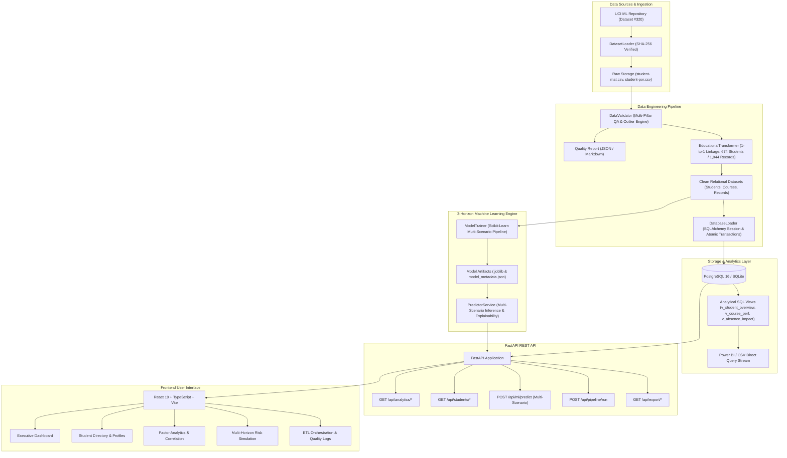

# DataPulse — Architecture & System Design Documentation

DataPulse is an enterprise-grade university analytics and predictive intelligence platform designed to ingest educational datasets, validate schema conformance, store normalized entities in relational storage, compute descriptive KPIs, and execute real-time machine learning predictions for academic student risk.

---

## 1. System Architecture Diagram

---

## 2. Component Architecture

### 2.1 Ingestion & Extraction Layer (`src/ingestion/`)
- Downloads authentic educational data directly from the UCI Machine Learning repository.
- Computes cryptographic SHA-256 hashes to guarantee data provenance.
- Provides a reproducible synthetic generation fallback when external networks are unavailable.

### 2.2 Preprocessing & Multi-Pillar Validation Layer (`src/preprocessing/validator.py`)
- Enforces strict Pydantic v2 schemas across 33 academic and demographic variables.
- Detects domain mismatches, missing values, duplicates, and statistical outliers using the Interquartile Range (IQR).
- Calculates institutional Data Quality Scores across 5 pillars: Completeness, Validity, Key Integrity, Outlier Regularity, and Granularity (Overall score: **91.2 / 100**).

### 2.3 Feature Engineering Layer (`src/preprocessing/transformer.py`)
- Resolves student entities across multi-course enrollments via **1-to-1 occurrence-ranked linkage (`cumcount()`)**, completely eliminating intra-course duplicate collisions.
- Resolves **674 unique students** and preserves **1,044 enrollment records** as first-class entities.
- Computes composite features: `parent_edu_avg`, `study_to_social_ratio`, `alcohol_index`, `grade_delta`, and `academic_risk`.

### 2.4 3-Horizon Machine Learning Pipeline (`src/ml/`)
- Eliminates target leakage by training and benchmarking models across three distinct time horizons:
  - **Scenario A**: Early Intake Warning (Pre-Grades) — uses only intake demographics and behavioral factors (ROC-AUC: 0.818).
  - **Scenario B**: Mid-Term Evaluation (Post-Period 1 with G1) (ROC-AUC: 0.931).
  - **Scenario C**: Late-Stage Forecasting (Post-Period 2 with G1 and G2) (ROC-AUC: 0.971, MAE: 0.76 pts).
- Evaluates models using Stratified 5-Fold Cross Validation.
- Persists serialised artifacts using `joblib`.

### 2.5 REST API Backend (`backend/app/`)
- High-throughput asynchronous FastAPI framework.
- CORS middleware with strict allowed origins, automatic OpenAPI / Swagger specifications, structured exception handling, and database session lifecycles.

### 2.6 Frontend Platform (`frontend/`)
- Modern enterprise SaaS aesthetic built with React 19, Vite, TypeScript, Tailwind CSS, and Recharts.
- Multi-horizon risk simulation engine, live analytics charts, and student directory with filtering and pagination.
