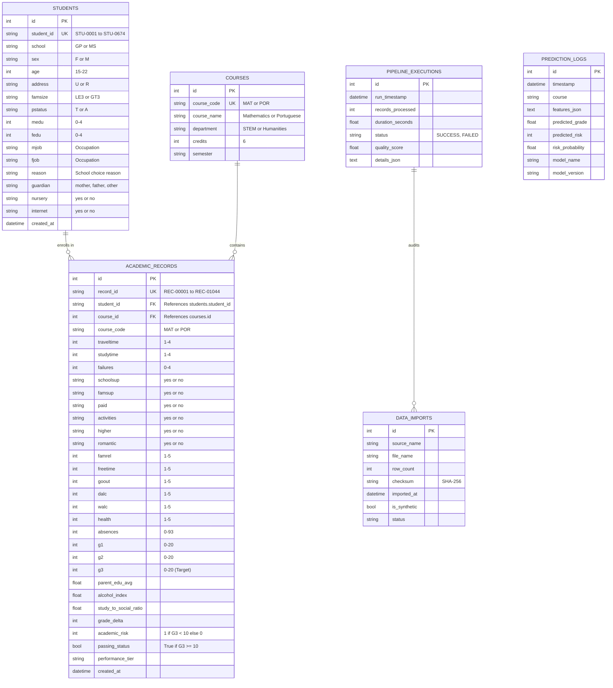

# DataPulse — Relational Database Architecture

## 1. Entity-Relationship (ER) Diagram

---

## 2. Table Schemas & Indices

1. **`students`**: Represents unique student individuals (674 resolved entities). Indexed on `student_id`.
2. **`courses`**: Course registry (`MAT` and `POR`). Indexed on `course_code`.
3. **`academic_records`**: Autonomous course enrollment instances (1,044 records). Compound index on `(student_id, course_id)` and single index on `academic_risk`.
4. **`pipeline_executions`**: Audits ETL and ML training cycles. Indexed on `run_timestamp`.
5. **`prediction_logs`**: Logs all inferences made through the REST API for model drift auditing.
6. **`data_imports`**: Tracks ingested CSV files and cryptographic checksums.

---

## 3. Analytical SQL Views

- `v_student_overview`: Denormalized analytical view combining demographics, course info, and academic indicators.
- `v_course_performance`: Aggregated metrics comparing enrollment counts, pass rates, average grades, and absences across subjects.
- `v_risk_analysis`: Evaluates correlations between academic risk and past failures, study habits, and alcohol consumption.
- `v_absence_impact`: Binned analysis showing grade degradation across cumulative absenteeism tiers.
- `v_performance_distribution`: Distribution of students across the 4 institutional tiers (*Needs Support*, *Satisfactory*, *Good*, *Excellent*).
